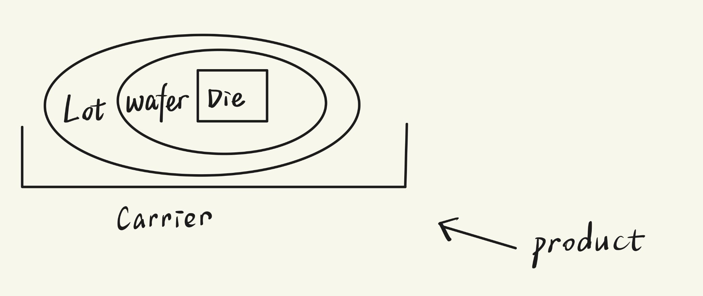

# 第一周作业模板

Windows 项目入门与 AI 协作

本周建议使用同目录的 Word 版 `W01_作业模板.docx`，复制为 `W01_我的作业.docx` 后填写。若选 Markdown，请将本文件复制为 `docs/notes/W01_我的作业.md`；只需提交其中一种格式。

以下路径均相对于项目根目录，即 README.md 和 environment.yml 所在文件夹。图、截图和长输出可放入 docs/notes/W01_附件/，在对应题目写明文件路径。将“[填写]”替换成自己的内容，答案较长时可继续输入。

### 基本信息

**姓名与日期：**

师小雅；2026/11/2

**Windows 版本与架构：**

Windows 10 家庭中文版；x64。

**GitHub 用户名与个人仓库链接：**

GitHub 用户名：Isabella20070904；个人仓库：https://github.com/Isabella20070904/wafer-scheduling-homework

**师兄能否访问仓库：**

可以。GitHub 注册、模板访问、个人仓库创建和访问权限设置均已完成。

## A1 我怎样理解 AI

用自己的话说明训练与推理、token、上下文与窗口、注意力机制；举例解释无关信息和过长会话怎样增加负担。

**我的理解与例子：**

训练：大量文本让ai猜下一个字是啥  
推理：根据训练好的模型生成回答  
token：单位  
上下文：当前回答能看到的全部信息  
注意力机制：生成token时回头看当前上下文的内容，打个分，看看和当前回答的关系大小  
无关信息会稀释掉注意力，占用更多的token

## A2 新会话交接

**当前目标：**

完成 Windows 项目环境配置：核对 VS Code、Git 和 PowerShell；配置 Conda 的 `wafer-scheduling` 环境；安装并核对 Microsoft Python 扩展；选择 Python 3.11 解释器；运行 `scripts/check_env.py` 并记录结果。

**当前系统环境（Windows、Shell、Python 等）：**

Windows x64；VS Code 终端使用 PowerShell 5.1；Conda 26.7.1 安装在 `E:\Users\HP\miniconda3`；项目环境为 `wafer-scheduling`；该环境使用 Python 3.11.18。

**项目真实路径：**

D:\wafer-scheduling-homework\wafer-scheduling-homework

**相关文件：**

docs/notes/W01_我的作业.md；docs/notes/photo/1.png；README.md；environment.yml；scripts/check_env.py

**已验证结果：**

仓库根目录中存在 README.md、environment.yml、docs、scripts 等项目文件；origin 指向个人仓库，当前分支配置为 main。

**未解决问题：**

[填写]

**新会话中 AI 如何复述；我核对或纠正了什么：**

[填写]

## B1 从账号和空目录到项目

**GitHub 注册、模板访问与个人仓库创建情况：**

均已完成：已注册 GitHub，已访问源模板，并使用模板创建了个人公开仓库 `Isabella20070904/wafer-scheduling-homework`。

源模板：https://github.com/HawkW1027/wafer-scheduling-learning

**我创建的空目录路径；克隆后的项目根目录：**

空目录：D:\wafer-scheduling-homework；克隆后的项目根目录：D:\wafer-scheduling-homework\wafer-scheduling-homework

**实际 clone 命令与结果（不含令牌）：**

[填写]

**git remote -v 的结果；origin 是否指向我的仓库：**

origin  https://github.com/Isabella20070904/wafer-scheduling-homework.git（fetch）  
origin  https://github.com/Isabella20070904/wafer-scheduling-homework.git（push）  
是，origin 指向我的个人仓库。

## B2 工具与环境

**VS Code 版本与 Git 版本：**

VS Code 1.144.0；Git 2.55.0.windows.3。

**Conda 发行版、版本与安装路径：**

Miniconda；Conda 26.7.1；安装路径为 `E:\Users\HP\miniconda3`。已核对环境列表，其中存在 `wafer-scheduling`：`E:\Users\HP\miniconda3\envs\wafer-scheduling`。

**VS Code 终端使用的 Shell 与项目环境名：**

Shell：PowerShell 5.1；项目环境名：`wafer-scheduling`。VS Code 设置已启用 `python.terminal.activateEnvironment`；如果新终端未显示环境名，应重新启动 VS Code 终端并核对。

**实际 Python 路径与版本：**

`E:\Users\HP\miniconda3\envs\wafer-scheduling\python.exe`；Python 3.11.18。

**谁执行、工作目录、检查命令与输出：**

执行者：AI；工作目录：`D:\wafer-scheduling-homework\wafer-scheduling-homework`。先激活项目环境，再运行检查脚本：

```powershell
conda activate wafer-scheduling
python scripts/check_env.py
```

实际结果：`CONDA_DEFAULT_ENV=wafer-scheduling`，`CONDA_PREFIX=E:\Users\HP\miniconda3\envs\wafer-scheduling`；Python 路径为 `E:\Users\HP\miniconda3\envs\wafer-scheduling\python.exe`，版本为 3.11.18，Python prefix 正确指向 `wafer-scheduling` 环境；项目目录判断为 True，练习文件存在判断为 True。说明 PowerShell 已加载 Conda 初始化，项目环境也已实际激活成功。

**终端与编辑器运行 check_env 的路径是否一致；我的判断：**

本次使用项目根目录下的 Conda 环境解释器运行，路径为 `E:\Users\HP\miniconda3\envs\wafer-scheduling\python.exe`，版本为 Python 3.11.18，与 `environment.yml` 的要求一致。之后在 VS Code 中应通过状态栏选择同一路径，再用“Run Python File in Terminal”复核一次。

## B3 VS Code 基础

**打开项目文件夹与打开单个文件的区别：**

打开项目文件夹后，VS Code 能建立完整文件树、识别项目根目录和 `.vscode` 设置；打开单个文件只能编辑该文件，不能完整获得项目级路径、终端和解释器配置。

**文件树与编辑区分别是什么：**

文件树用于浏览和定位项目文件；编辑区用于打开、修改和保存当前文件。本次从文件树打开 `docs/notes/W01_我的作业.md`，在编辑区填写并保存。

**终端与工作区分别是什么：**

终端用于执行 PowerShell、Git、Conda 和 Python 命令；工作区是 VS Code 当前打开的项目文件夹及其项目级设置。本项目工作区根目录是 `D:\wafer-scheduling-homework\wafer-scheduling-homework`。

**扩展与 Python 解释器分别是什么：**

扩展是给 VS Code 增加 Python 编辑、运行、调试和环境选择能力的软件组件；Python 解释器是实际执行代码的程序。本机已安装 Microsoft Python 扩展 `ms-python.python 2026.10.0`、Pylance `2026.4.1`、debugpy `2026.6.0` 和 Python Environments `1.40.0`。本项目应选择 `E:\Users\HP\miniconda3\envs\wafer-scheduling\python.exe`，扩展本身不等于解释器。

**我怎样打开终端、定位文件、复制与保存作业，并重新打开核对：**

在 VS Code 中选择 Terminal → New Terminal，确认终端为 PowerShell；用文件树展开 `docs/notes` 并打开本文件；使用 Ctrl+S 保存。需要核对时关闭文件后从文件树重新打开，或按 Ctrl+Shift+V 预览 Markdown；终端中先确认 `Get-Location` 为项目根目录，再运行 `E:\Users\HP\miniconda3\envs\wafer-scheduling\python.exe scripts/check_env.py`。

**我采用的作业格式与最终保存路径：**

Markdown；D:\wafer-scheduling-homework\wafer-scheduling-homework\docs\notes\W01_我的作业.md

**一次有帮助的 AI 提问、追问与自己的理解：**

[填写]

## C1 制造对象

画出 Wafer、Die、Lot、Product、Carrier 的关系图；说明换载具后哪些信息要保持关联。核对晶圆讲义 1.1、1.2。

**关系图（可直接插入图片，或填写附件路径）：**



**换载具后需要保留的关联信息：**

Lot id绑定的产品信息、wafer与slot之间的映射、工艺历史与在制状态。

**实际送入设备的对象与最小被加工单元；我讨论的设备或工艺情境：**

前期晶圆制造设备：wafer、晶圆测试：送wafer测die、封装送die

**我向 AI 提问和追问的内容：**

[填写]

**对照讲义后确认或修正的一点：**

[填写]

## C2 制造过程

说明五种工艺的作用，再用一个材料层的例子解释为什么会重复加工。核对晶圆讲义 2.1。

| 工艺 | 用自己的话说明作用 |
| --- | --- |
| 沉积 | 铺一层原材料 |
| 光刻 | 画图 |
| 刻蚀 | 根据光刻的图把不用的去掉 |
| 清洗 | 把不要的洗干净 |
| CMP | 抛光磨平 |

**材料层的例子与重复加工的原因：**

芯片不是多片 wafer 叠起来，而是在一片硅晶圆上逐层沉积、图形化、刻蚀，形成器件和多层互连。

```text
封装外壳
────────────────
最上层金属布线
绝缘层
金属层
绝缘层
金属层
绝缘层
通孔连接上下层
───────────────
BEOL：多层互连
───────────────
接触孔
晶体管（源极、漏极、栅极）
───────────────
硅晶圆（地基）
FEOL：器件层
```

下面 FEOL 主要做晶体管等器件，相当于把“要工作的功能单元”搭好；上面 BEOL 主要做多层金属线、通孔和绝缘层，把器件按设计连接起来，让它们能协同工作，并防止导线之间短路。一句话：下面 FEOL 搭好功能单元，上面 BEOL 布好连接网络，合起来才是一个能工作的芯片。

**我向 AI 的追问，以及确认或修正的一点：**

非常神秘 我一开始以为芯片是很多个wafer叠加起来😂

## C3 调度思考

条件：只有设备 M1，时刻 0 可用；Lot A、B 均已就绪且有加工资格。A 连续加工 4 分钟，B 加工 1 分钟；加工不可中断，不考虑准备与运输时间。核对调度讲义 1.1、1.3。

先画或描述两种时间安排，再填写下表；单位为分钟。

| 顺序 | Lot | 开始时刻 | 完工时刻 | 等待时间 |
| --- | --- | --- | --- | --- |
| A→B | A | 0 | 4 | 0 |
| A→B | B | 4 | 5 | 4 |
| B→A | B | 0 | 1 | 0 |
| B→A | A | 1 | 5 | 1 |

| 顺序 | 全部任务结束时刻 | 平均等待时间 |
| --- | --- | --- |
| A→B | 5 | 2 |
| B→A | 5 | 0.5 |

**两种时间安排的图、描述或附件路径：**

M1 上，A→B 为 A:[0,4)、B:[4,5)；B→A 为 B:[0,1)、A:[1,5)。

**关注全部结束时刻与关注平均等待时，我怎样评价这两种安排：**

全：相同。平：B→A更优。

**如果关心交期，还缺哪些信息：**

A、B 的交期 

**这个例子的输入与决策：**

输入：单台机器 M1，时刻 0 起可用；A、B 均为单工序作业且已就绪，非抢占加工，不考虑准备和运输。  
决策：确定 M1 上的加工顺序，即 A→B 或 B→A；机器分配已确定为 M1，开始和完工时刻由顺序及尽早开始规则推出。

**两条约束与一个评价目标：**

机器容量约束 非抢占约束 最小化平均等待时间

**我向 AI 的追问，以及核对或修正的内容：**

[填写]

## B4 从保存到 commit 和 push

提交前填写本节。先请 AI 根据实际仓库状态解释操作，由自己检查文件并完成提交。

**我向 AI 询问的步骤与后续追问：**

[填写]

**我对保存、暂存、commit、push 的解释：**

保存是存在本地电脑上，暂存是把改的东西打包放进暂存区，commit是本地提交，push是推送到远程仓库。

**本次选择提交的文件；我检查了哪些内容：**

作业模版。

**准备执行的 commit 与 push 命令（不含令牌）：**

[填写]

**当前分支；origin 指向的个人仓库：**

main；https://github.com/Isabella20070904/wafer-scheduling-homework.git

Word 文档通常不能在 git diff 中逐行显示正文；提交前用 Word 或 WPS 打开检查，并结合 git status 核对文件名。保存并关闭文档后再提交。

## 提交前自查与待解决问题

- [ ] 账号、模板获取、空目录与 origin 已核对。

- [ ] VS Code、Git、Conda 与 Python 3.11 项目解释器可用。

- [ ] 已完成 AI 基础、新会话交接与一次实际操作核验。

- [ ] 已独立完成 C1—C3，并能解释自己的图、例子和手算。

- [ ] 答案和附件已保存到项目内，选择提交的文件与本次作业一致。

**仍不确定的问题：**


**未完成项、报错与补做计划（没有则写“无”）：**

无

## 提交后在提交入口另附

完成 commit 和 push 后，在提交入口或消息中提供下列信息；不必把包含本文件的最终提交编号写回本文件。

个人仓库链接：
实际分支：
包含答案的完整 commit 编号：
作业相对路径：docs/notes/W01_我的作业.docx（选 Markdown 时改为 .md）
推送结果与网页核对结果：

打开 GitHub 的对应仓库与分支，核对文件和提交编号。Word 文件若不能在线预览，下载本次提交中的文件，用 Word 或 WPS 打开核对答案；确认师兄也可以访问。
